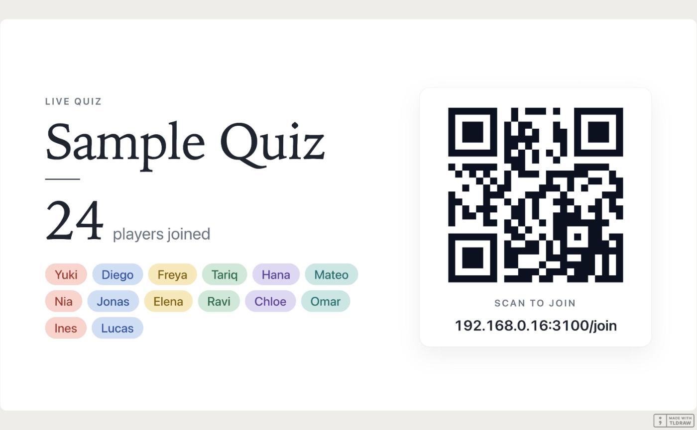
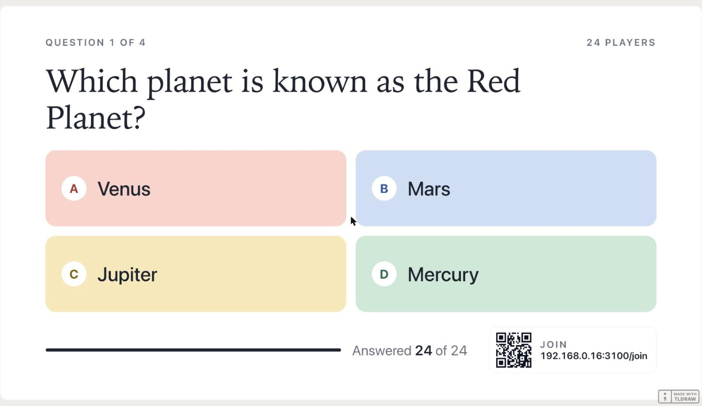
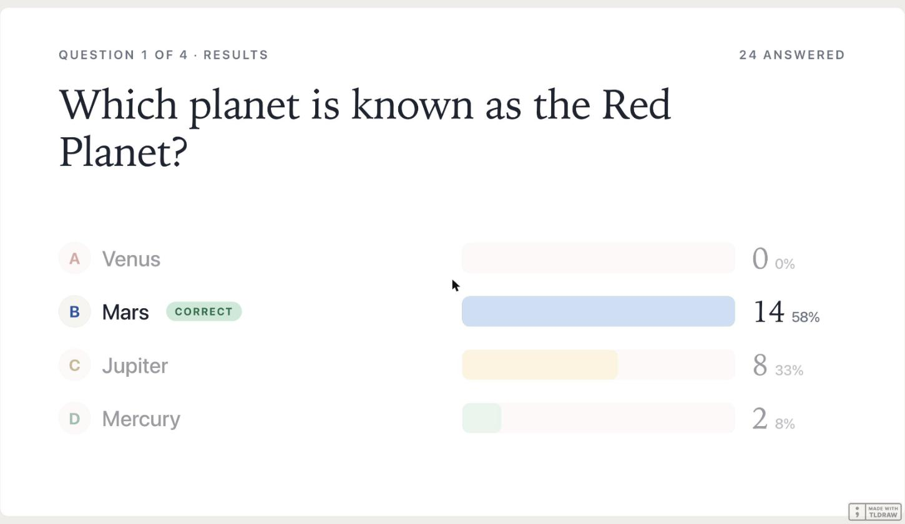
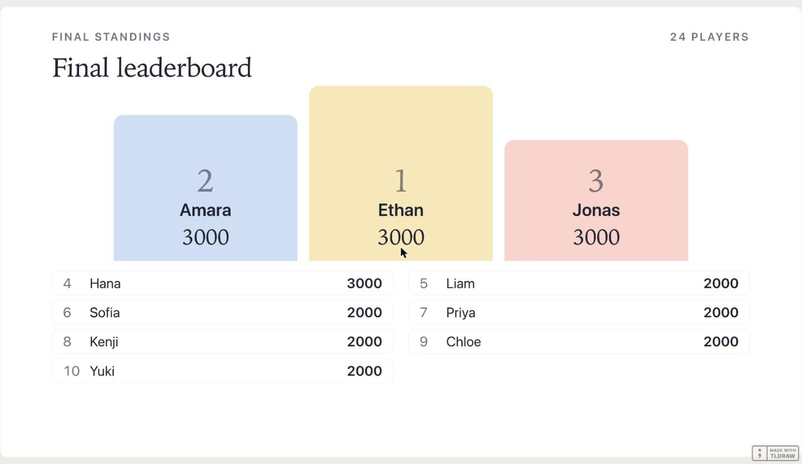
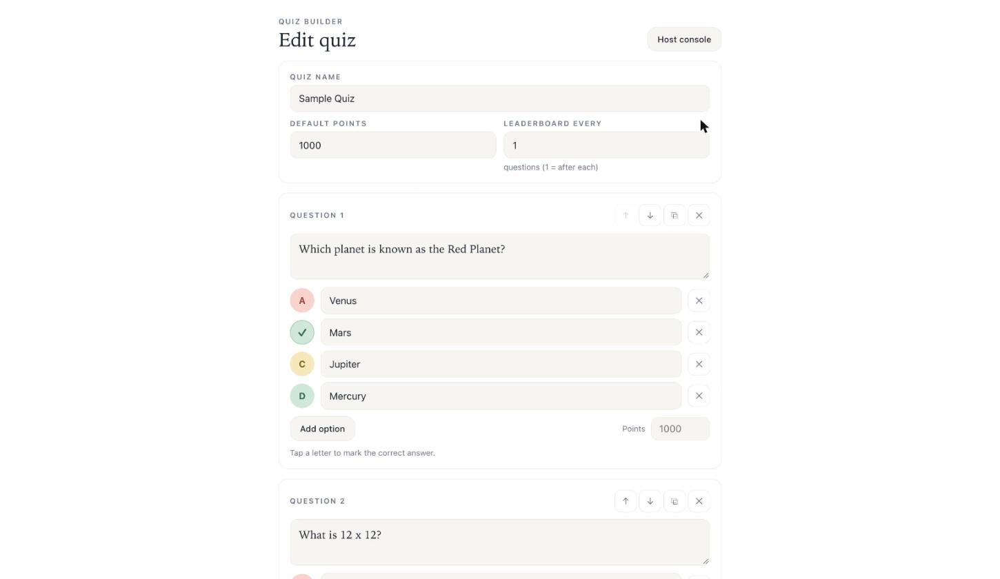
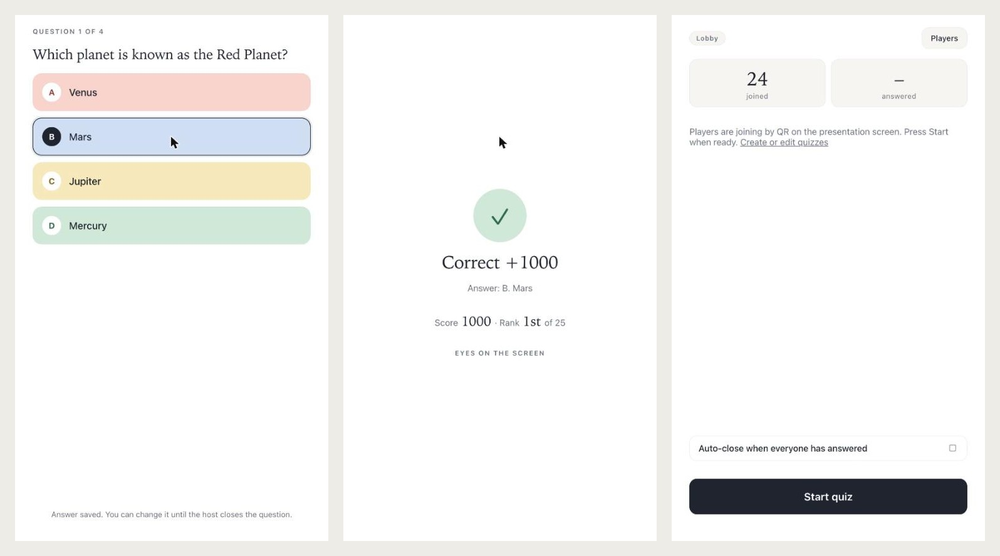

# LiveQuiz Community

A small, self-hosted live quiz for classrooms, workshops and meetups. Run it on your laptop, show the screen on a projector, and let everyone join from their phone by scanning a QR code. No accounts, no database, no cloud service.

- **Build quizzes in a form.** Open `/create`, name the quiz, add questions and options, tap the correct answer, save. The quiz is stored as a plain JSON file.
- **Run it live.** The host controls the quiz from their phone: start, close and reveal, show the leaderboard, next question.
- **Presentation screen on a tldraw canvas.** Live player count, "answered X of N", result bars, and a leaderboard after every question.
- **Made for up to ~80 players** on one small Node process.

## What it looks like

**Presentation screen** (projector): players scan the QR code, then each question, its results and a leaderboard appear on the screen.






**Quiz builder** (`/create`): name the quiz, add questions and options, tap a letter to mark the correct answer.



**On phones**: a player answers (left) and sees their result (middle); the host controls the quiz from their own phone (right).



## Quick start

Requires Node 20 or newer.

```bash
cd app
npm install        # once
npm start          # builds the web app and starts the server
```

The terminal prints the addresses and a host PIN:

```
  Present:  http://192.168.0.6:3000/present   (open on the projector laptop)
  Join:     http://192.168.0.6:3000/join
  Admin:    http://192.168.0.6:3000/admin   PIN 482913
  Create:   http://192.168.0.6:3000/create   (build or edit quizzes, same PIN)
```

1. Open **Create** to build a quiz (or use the included sample).
2. Open **Present** on the projector. It shows a QR code.
3. Players scan the QR code with their phones and enter a name.
4. Open **Admin** on your phone (scan the QR in the terminal, it pre-fills the PIN), pick the quiz, press **Start quiz**.

Phones must be on the same network as the machine running the server. Some school and guest Wi-Fi networks block device-to-device traffic ("client isolation"); if phones cannot reach the page, use your own router or a phone hotspot.

## Building quizzes

`/create` is a form: quiz name, default points, how often to show the leaderboard, and for each question the text, 2 to 6 options, and the correct answer (tap its letter). You can reorder, duplicate and delete questions, set per-question points, download the quiz as JSON, and delete quizzes you no longer need.

**Import**: paste or upload JSON from elsewhere. Besides this project's format, the importer understands common shapes: `quizTitle` or `name` for the title, `question` for the text, options as strings or `{ "text": ... }` objects, "A. " style prefixes, and the correct answer as an index, a letter (`"B"`) or the option text (`correctAnswer`).

Quizzes live in the `quizzes` folder as JSON files, so you can copy them, share them or keep them in git.

### Quiz file format

```json
{
  "title": "Sample Quiz",
  "leaderboardEvery": 1,
  "defaults": { "points": 1000 },
  "questions": [
    { "text": "Which planet is known as the Red Planet?", "options": ["Venus", "Mars", "Jupiter", "Mercury"], "correct": 1 },
    { "text": "How many continents are there?", "options": ["5", "6", "7", "8"], "correct": 2, "points": 500 }
  ]
}
```

- `correct` is the zero-based index of the right option.
- `points` per question is optional; `defaults.points` applies otherwise (1000).
- `leaderboardEvery` shows the leaderboard after every N questions. The last question always ends on a leaderboard.
- Extra fields such as `topic` and `explanation` are kept but not shown by the app.
- The file name is the quiz id. Files starting with `_` are ignored, which is handy for archived quizzes.
- Editing the quiz that is currently running is blocked until you reset the session.

## How a session works

1. **Lobby**: players join; the screen shows who is in.
2. **Question**: everyone answers on their phone and can change their answer until you close the question. The screen shows only how many have answered.
3. **Close & reveal**: the screen shows how many chose each option and marks the right one. Phones show correct or not, points and rank.
4. **Leaderboard**: top 10 with a podium, then **Next question**.
5. The final leaderboard ends the quiz; **Reset session** returns to the lobby, where you can pick another quiz.

Scoring is flat: points for a correct answer, none otherwise, with no timer. Ties are broken by the lower total answer time on correct answers, then by join order.

## Configuration

Environment variables (all optional):

| Variable | Purpose |
|---|---|
| `PORT` | Server port (default 3000) |
| `ADMIN_PIN` | Host PIN. A random one is generated and printed if unset |
| `PUBLIC_URL` | URL to put in the QR code instead of the detected LAN address (for example behind a reverse proxy) |
| `QUIZZES_DIR` | Folder holding quiz JSON files (default `app/quizzes`) |
| `DEFAULT_QUIZ` | Quiz id selected at start |
| `AUTO_CLOSE_ALL_ANSWERED=true` | Close a question as soon as everyone has answered |
| `CREDIT_TEXT`, `CREDIT_URL` | Optional small footer on every slide and phone screen (off by default) |

Example: `ADMIN_PIN=123456 PORT=8080 npm start`

## Security notes

- The host console and quiz builder require the PIN. Wrong guesses are rate limited.
- The server is meant for a trusted local network. It serves plain HTTP; do not expose it to the internet without HTTPS in front of it.
- Players never receive the correct answer before you reveal it, and the display only receives totals.
- Nothing about players or answers is stored beyond the running session (plus a restart snapshot in `app/data`). Reset clears it.

## Docker

```bash
docker build -t livequiz-community .
docker run -p 3000:3000 -e ADMIN_PIN=123456 -e PUBLIC_URL=http://<your-lan-ip>:3000 \
  -v "$(pwd)/app/quizzes:/app/quizzes" livequiz-community
```

Mount the `quizzes` folder so quizzes you create are kept outside the container.

## Development

```bash
cd app
npm test                 # unit tests (session engine, quiz import and validation)
npm run typecheck
npm run dev:server       # server with live reload (set ADMIN_PIN)
npm run dev:web          # Vite dev server for the web pages
node scripts/bots.mjs 80 localhost:3000 <pin>   # end-to-end test with 80 simulated players
```

Layout: `app/shared` (pure session engine, quiz format, protocol types), `app/server` (HTTP, WebSocket, quiz API), `app/web` (player, host, presentation and builder pages; tldraw is only loaded on the presentation page), `app/quizzes` (quiz files).

## Licence and credits

Released under the MIT licence (see `LICENSE`).

The presentation screen is drawn with [tldraw](https://tldraw.dev) ([source](https://github.com/tldraw/tldraw)). **tldraw is not included in this repository.** It is a separate dependency that `npm install` downloads from the npm registry, under tldraw's own licence. Please read their [licence terms](https://tldraw.dev/community/license) and check that your use (for example commercial use) is covered before you deploy this.
